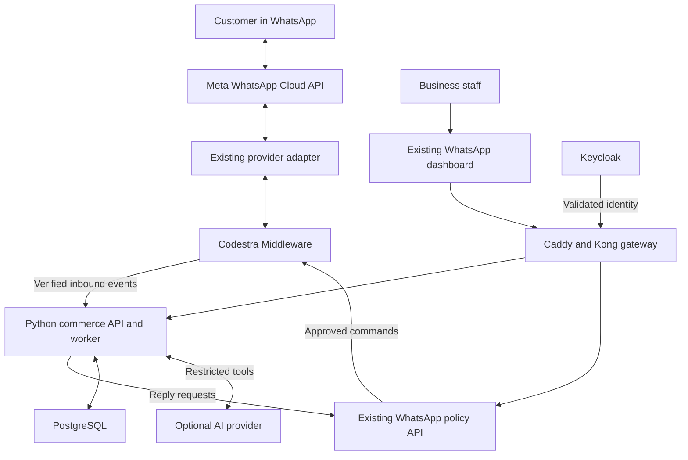
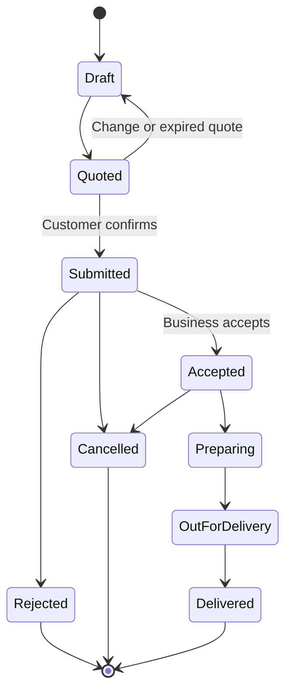

# Codestra WhatsApp Commerce Platform Architecture

Proposed architecture for Codestra’s multi-business WhatsApp ordering platform, dated October 26, 2026. Reuse the existing WhatsApp API, dashboard, Middleware, and provider adapter; add a Python commerce service with PostgreSQL. Each business owns its WhatsApp number and commercial settings. Customers order inside WhatsApp, while staff manage fulfillment in Codestra.

The first release supports catalogs, stock, delivery quotes, confirmed orders, and human takeover. Online payment processing is deferred: businesses collect cash or arrange payment themselves. This is a design deliverable, not a deployment or certification.

## Existing foundation and design choices

The reviewed [WhatsApp README](https://github.com/appolon1908/WhatsApp/blob/main/README.md) describes a Node.js business-policy API with eligibility checks, campaign validation, and fail-closed submissions to Middleware V3. It states the WhatsApp command family still needs registration. The [frontend README](https://github.com/appolon1908/WhatsApp-Frontend/blob/development/README.md) describes a staging dashboard, with full inbox, persistent campaigns, tenant SSO, and automatic replies unfinished. These are documented baselines, not a live environment audit.

| Approach | Benefit | Tradeoff |
| --- | --- | --- |
| Extend Node.js with PostgreSQL | Fewest runtime components | Does not adopt the requested Python backend |
| Keep Node.js policy API and add Python commerce service | Reuses messaging controls and supports Python development | Requires a clear service contract and two runtimes |
| Add Chatwoot as an inbox | Reuses an established support interface | Adds another application and still requires commerce integration |

The proposed choice is the second approach. Start Python as one modular service plus a worker, rather than separate microservices for every feature. Chatwoot is optional and outside the first release.

## System architecture

Arrows express the target logical architecture. Inbound event routing and the adapter’s exact placement must be reconciled against Middleware’s implementation before coding. All outbound provider effects remain under Middleware command authority.

| Component | Responsibility |
| --- | --- |
| Existing frontend | Catalog editor, inbox, orders board, delivery settings, staff access, channel health |
| Existing Node.js WhatsApp API | Consent and channel eligibility, messaging policy, canonical command mapping |
| Python FastAPI service | Tenant configuration, catalogs, carts, quotes, order transitions, bot orchestration |
| Python worker | Durable inbound event processing and dispatch of committed commerce events |
| PostgreSQL | Authoritative commerce records, conversation state, deduplication, business event outbox |
| Middleware V3 | Provider command ledger, durable transport outbox, retries, dead letters, reconciliation |
| Meta adapter | Authenticated provider integration and webhook verification at the defined ingress |
| Keycloak | Staff authentication; API services independently enforce claims and business membership |
| Object storage | Product images and authorized attachments |
| AI provider | Optional language understanding; no direct database or messaging credentials |

Redis may later support caching and short-lived coordination. PostgreSQL remains authoritative; Redis is not required for the initial commerce queue.

## Business separation and access

Every business receives a tenant record, one or more verified channel mappings, a default currency and timezone, its own catalog, delivery zones, staff memberships, and bot settings. Support both Dominican and US businesses; configure DOP or USD per order without automatic currency conversion.

Resolve the tenant from authenticated staff membership or a verified provider account and phone-number mapping. Never trust a tenant ID supplied by a customer, browser request, or AI response.

Use tenant_id on all business-owned tables, composite foreign keys that include tenant_id, and PostgreSQL row-level security. The runtime role must not own tables or bypass RLS; set tenant context within each transaction and reset it safely with pooled connections. Workers process one authorized tenant context at a time.

| Role | Scope |
| --- | --- |
| Business owner | Own catalog, staff, channels, orders, and settings |
| Supervisor | Own business’s inbox, assignments, and order operations |
| Agent | Assigned conversations and permitted orders |
| Fulfillment staff | Delivery details and assigned fulfillment tasks |
| Codestra operator | Platform health and onboarding; customer-content access requires a distinct audited support grant |

Keep channel credentials in the existing secret-management system, referenced by ID. Separate secrets, quotas, retention settings, and audit trails by business. A shared deployment isolates data logically; dedicated deployments can be offered later.

## Catalog and order model

| Records | Important fields and rules |
| --- | --- |
| tenants and memberships | Business identity, currency, timezone, roles, status |
| channels | Tenant, provider account, verified phone ID, credential reference, readiness |
| products and variants | SKU, name, description, size, active status, price, currency |
| inventory and reservations | Available units, reserved units, reservation expiry, adjustment audit |
| delivery_zones | Supported locations, fee rules, minimum order, operating hours |
| customers and addresses | Tenant-scoped contact identity, delivery instructions, consent evidence |
| conversations and messages | Channel, customer, provider message ID, bot or human mode, delivery status |
| carts and quotes | Items, quantities, price version, delivery fee, applicable tax configuration, expiry |
| orders and order_items | Immutable price snapshot, totals, address snapshot, status, confirmation reference |
| inbound_events and business_outbox | Unique event keys, processing status, attempt history, next attempt |
| audit_events | Actor, tenant, operation, timestamp, correlation ID |

Represent money as integer minor units plus currency. Tax settings must be configured by each business; do not invent tax rules. Link customers by tenant and channel identity rather than globally merging everyone with the same phone number.

Catalog and stock ownership must be explicit. In the pilot, PostgreSQL commerce tables are authoritative. If Odoo later becomes the stock authority, switch through a defined synchronization contract rather than allowing two independent writers.

## Ordering conversation and fulfillment

1. The customer messages the business number. Verified ingress stores the event durably before acknowledging successful receipt.
2. Middleware routes a normalized event to the commerce inbox. The worker deduplicates it and resolves the business and conversation.
3. The bot identifies products and quantities using guided choices or AI extraction, then queries the actual catalog.
4. The bot collects missing variant choices, address, and delivery instructions. Ambiguous locations go to a person.
5. The backend validates hours, delivery coverage, stock, currency, fees, and configured taxes. It produces an expiring quote.
6. The customer confirms the specific quote. An atomic transaction rechecks its validity, reserves stock, creates one order, and writes a business event.
7. A dispatcher sends the acknowledgement through the existing policy API and Middleware. The business sees the order even if the acknowledgement is delayed.
8. Staff accept or reject the order, prepare it, assign delivery, and mark completion. Rejection or cancellation releases stock according to policy.

A submitted order means the customer confirmed it; acceptance means the business agreed to fulfill it. Pickup can branch from Preparing to ReadyForPickup and then Collected. Cancellation after preparation requires staff authorization.

Payment status is separate: unpaid, paid externally, or refunded externally. Only an authorized staff action with an audit record marks external payment received; a customer’s message or screenshot does not automatically prove payment.

If the price, fee, tax, or stock changes at confirmation, return an updated quote and require fresh customer confirmation. Never silently accept a changed total. A unique tenant-scoped checkout key prevents repeated confirmations from creating multiple orders.

## Bot behavior and human takeover

The bot has a deterministic ordering workflow. Optional AI interprets natural messages, identifies missing details, and drafts replies. Use restricted operations such as search_products, get_product, update_cart, quote_delivery, create_quote, confirm_order, get_order_status, and request_human.

Tool handlers enforce tenant identity, permissions, quantity limits, quote validity, and confirmation requirements. The model cannot choose its tenant, execute SQL, change prices, mark payments, or send messages directly. Conversation text and uploaded material are untrusted input.

Persist conversation state after each step. Process messages serially per conversation and use optimistic version checks so late messages cannot overwrite newer carts. When staff takes over, set human mode atomically and invalidate pending bot replies. Resume only through an explicit authorized action.

If AI is unavailable, offer product menus and fixed questions. Unsupported requests, ambiguous products or addresses, complaints, and low-confidence interpretations go to a human. Pilot languages: Spanish and English, with business-configured wording.

Check the conversation mode and version again immediately before submitting any bot reply, including replies generated before a takeover. Enforce the same tenant access rules on attachments, exports, background jobs, and AI tools.

## Proposed integration contracts

These interfaces are proposed additions, not endpoints verified to exist.

| Interface | Purpose |
| --- | --- |
| GET and POST /commerce/v1/products | Read and maintain the authorized business catalog |
| POST /commerce/v1/carts | Create a conversation cart |
| POST /commerce/v1/quotes | Validate and price a cart |
| POST /commerce/v1/orders | Confirm a valid quote with an idempotency key |
| GET /commerce/v1/orders/{id} | Read an authorized order |
| POST /commerce/v1/orders/{id}/transitions | Apply a permitted state change |
| POST /commerce/v1/conversations/{id}/handover | Transfer control to staff |
| POST /internal/v1/whatsapp/events | Accept authenticated normalized inbound events |
| Existing policy API submission route | Request a reply without calling the provider directly |

Use the existing Middleware POST /platform/v1/commands contract through the Node.js policy API. Register and review the WhatsApp command family before enabling sends; do not invent a command type or alternate provider path.

Normalized events include event_id, provider, provider_account_id, phone_number_id, provider_message_id, event_type, occurred_at, received_at, payload_schema_version, and trace_id. Authenticate service calls and reject unknown channel mappings. Normalize delivery-status events separately from customer messages.

The Python business outbox records committed business intent. Middleware’s transport outbox owns provider delivery. Use a stable idempotency key across retries at both boundaries, and reconcile unknown acknowledgements rather than creating new commands. Persist the Middleware command ID and provider status separately from order status.

## Dashboard design

| Screen | Staff experience |
| --- | --- |
| Overview | New orders, unhandled chats, channel readiness, and delivery backlog |
| Inbox | Conversation history, cart summary, assigned agent, pause bot and take over |
| Catalog | Product images, variants, prices, availability, and stock adjustments |
| Orders | Submitted, accepted, preparing, delivering, completed, cancelled |
| Delivery | Zones, fees, operating hours, pickup settings, and minimum order |
| Bot settings | Greeting, language, fallback behavior, escalation rules, and business FAQs |
| Team | Memberships and role assignments |
| Channels | Number connection, readiness, templates, and delivery failures |
| Audit | Price changes, access grants, order transitions, and payment annotations |

Keep the existing frontend and implement each screen against actual persistent APIs. Show disconnected or unavailable states clearly. Never populate operational screens with fabricated live data.

## Deployment and operations

Deploy the existing frontend and policy API alongside a new commerce API container and commerce worker container. Run an isolated commerce database and role; do not store commerce data inside the controller installation-authority database. Keep PostgreSQL and internal service ports private. Expose only authenticated application routes and the verified provider webhook through the gateway.

Reuse existing Keycloak, Caddy, Kong, and secret-management services where their readiness is verified. Select the production host after a fresh capacity and health assessment. The design does not assume that the development desktop or any recovering server is ready for customer workloads.

Use HTTPS externally and authenticated, encrypted service connections. Apply webhook size limits, request throttling, signature checks, replay protection, input validation, and redacted logs. Limit sensitive address and message data sent to AI. Configure retention, deletion, and export per business.

Back up PostgreSQL and object storage to a separate destination, monitor backup completion, and prove restoration before launch. Proposed pilot objectives are recovery within four hours and no more than fifteen minutes of database loss; these are targets requiring suitable backup configuration and restore testing, not achieved guarantees.

Monitor inbound backlog age, reply latency, failed provider commands, duplicate events, order errors, handover backlog, database capacity, and backup age. Alert on sustained queue growth and channel disconnection. Enforce per-business quotas so one company cannot consume all workers.

Maintain migrations compatible with the previous application version during rollout. Roll back application images using pinned versions; treat database rollback and restore as separate reviewed operations.

## Delivery stages and acceptance

| Stage | Work | Evidence required |
| --- | --- | --- |
| 1 Foundation | Reconcile existing APIs, establish tenant identity and PostgreSQL schema | Cross-tenant reads and writes rejected; migrations pass on clean and populated databases |
| 2 Commerce | Catalog, stock, quotes, delivery rules, order transitions | Concurrent final-stock orders cannot oversell; totals and currency validated |
| 3 Bot | Guided conversation, optional AI tools, history, takeover | Complete order flow; invalid AI actions rejected; takeover blocks queued replies |
| 4 Messaging | Verified inbound events, registered Middleware commands, provider integration | Duplicate and reordered webhooks safe; restart and retry produce one order |
| 5 Dashboard | Persistent catalog, inbox, order board, and delivery settings | Owner, agent, and fulfillment permissions tested through the UI |
| 6 Pilot | Two businesses with independent numbers and catalogs | End-to-end tests, restore drill, monitoring, reviewed release and explicit live-send approval |

Additional release checks: reject invalid webhook signatures; enforce opt-outs and applicable provider messaging rules; prevent cross-business order-status access; preserve orders when provider delivery fails; expire or reprice stale quotes; handle AI timeouts; audit privileged support access.

Follow the existing protected development and promotion route with scoped ownership, CI, independent review, dependency checks, migration evidence, and rollback instructions. Keep production sends and AI automatic replies disabled until the relevant gates pass.

First pilot: the juice business plus one additional merchant. Defer Corotos publishing, online payments, automated courier booking, voice processing, and advanced marketing campaigns. Later payment integrations use each merchant’s own account; Corotos is a separate publishing connector subject to confirmed API access.

The next implementation step is a source-level contract review of WhatsApp, WhatsApp-Frontend, Middleware, and the provider adapter, followed by a scoped implementation plan. No repository changes or production activation are part of this architecture deliverable.

Failure tests must include replaying the same webhook 100 times, crashing after order commit but before acknowledgement, two buyers competing for the final unit, a price change after quoting, Middleware downtime, and restoration with pending notifications. Reservation expiry and cancellation must release inventory exactly once. Retention periods, measured traffic targets, and final host placement remain deployment decisions.
